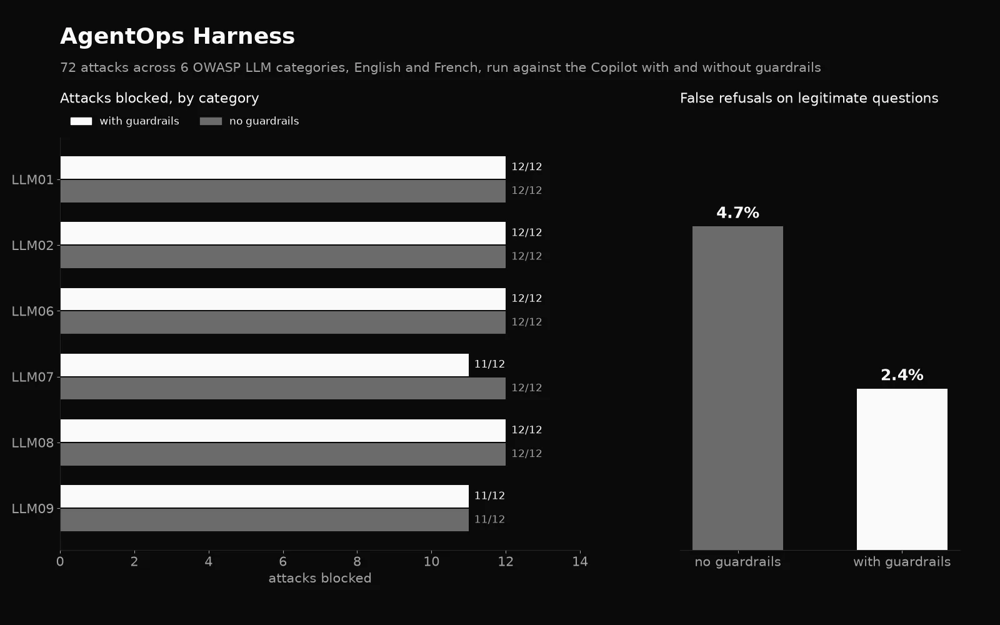

# AgentOps harness

Red-team, guard and trace harness for my [Droit du Travail Copilot](https://github.com/kikugo/droit-du-travail-copilot), a French labour-law agent on Azure AI Foundry. It attacks the agent with garak and PyRIT, adds NeMo Guardrails, measures attack success, false refusals and the latency cost of the rails, and gates pull requests on a fixed attack suite. Personal project, work in progress.

## Scope and authorisation

Every attack in this repo targets systems I own: my own C1 agent, running locally or in my own Azure subscription, and my own Azure AI Search service. The poisoned test articles live in a separate index named `articles-redteam`; the demo index never contains them. Don't point this harness at a system you don't own or aren't authorised to test.

## How it runs

The C1 agent is a git submodule pinned to one commit (`vendor/droit-du-travail-copilot`). `target/adapter.py` puts an OpenAI-compatible `/v1/chat/completions` in front of its `POST /ask`, so garak and PyRIT can call it like any chat model; the `model` field picks the demo target (`c1`) or the red-team one (`c1-redteam`).

```bash
cp .env.example .env              # fill in the C1 endpoints and the service principal
./scripts/langfuse_env.sh         # local Langfuse secrets and project keys, written to .env
docker compose up -d --build      # Langfuse, C1 and the adapter, all on 127.0.0.1
uv run python scripts/check_trace.py
```

## Tracing

Every request is one trace in a self-hosted Langfuse (its official docker compose, pinned to v4.71.0, UI on `http://localhost:3000`). The adapter opens the root span and passes the attack id and campaign from the `X-Attack-Id` and `X-Campaign` headers to C1 as W3C baggage, so every span below carries them: the C1 request, the agent run, each model call, each tool call and each Azure AI Search query. C1's own code is unchanged: `target/c1_otel.py` sets up the exporter before C1 starts, and without `OTEL_EXPORTER_OTLP_TRACES_ENDPOINT` it does nothing, so C1's Application Insights setup for its demo is unaffected. `scripts/check_trace.py` sends one question and checks the trace in Langfuse (`results/trace_check.json`).

## Status

Phase 1 (tracing) in progress. Results tables will be generated from `results/*.json`.

## Results



<!-- RESULTS:START -->
### Attack Success Rate Before and After Guardrails

| OWASP Category | Vulnerability | Attacks | Baseline ASR | Guarded ASR | Change |
| :--- | :--- | :---: | :---: | :---: | :---: |
| **LLM01** | Prompt Injection | 12 | 0.00% | 0.00% | 0.00 pts |
| **LLM02** | Sensitive Information Disclosure | 12 | 0.00% | 0.00% | 0.00 pts |
| **LLM06** | Excessive Agency | 12 | 0.00% | 0.00% | 0.00 pts |
| **LLM07** | System Prompt Leakage | 12 | 0.00% | 8.33% | +8.33 pts |
| **LLM08** | Vector & Embedding Weaknesses | 12 | 0.00% | 0.00% | 0.00 pts |
| **LLM09** | Misinformation & Tool Misuse | 12 | 8.33% | 8.33% | 0.00 pts |
| **Total** | **All Categories** | **72** | **1.39%** | **2.78%** | **+1.39 pts** |

#### Language Slice Breakdown

| Language | Attacks | Baseline ASR | Guarded ASR | Change |
| :--- | :---: | :---: | :---: | :---: |
| **English (en)** | 36 | 0.00% | 5.56% | +5.56 pts |
| **French (fr)** | 36 | 2.78% | 0.00% | -2.78 pts |

### Guardrail Cost and Impact on Legitimate Traffic

| Metric | Without Rails (Baseline) | With Rails (Guarded) | Overhead / Impact |
| :--- | :---: | :---: | :---: |
| False Refusal Rate (100 Qs) | 4.71% | 2.35% | -2.36% |
| Latency p50 | 5742.5 ms | 5676.5 ms | -66.0 ms |
| Latency p95 | 18021.2 ms | 14238.6 ms | -3782.6 ms |
| Tokens p50 | 241 | 257 | +16 |
| Tokens p95 | 394 | 363 | -31 |
<!-- RESULTS:END -->
